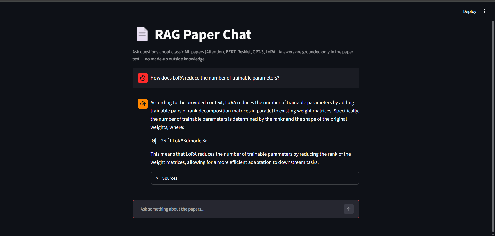

 # RAG Paper Chat 📚🤖

A Retrieval-Augmented Generation (RAG) application built from scratch to chat with Machine Learning research papers. This project allows you to ask natural language questions, and it retrieves relevant sections from local PDFs (like "Attention Is All You Need") to generate accurate, grounded answers using a local LLM.

## 🚀 Features
- **PDF Ingestion**: Extracts text from research papers and splits them into overlapping chunks.
- **Local Embeddings**: Uses HuggingFace embeddings to convert text chunks into vectors.
- **Vector Database**: Stores embeddings locally using ChromaDB.
- **Local LLM Integration**: Uses Ollama (Llama 3.2) to generate final answers based *only* on the retrieved context.
- **Source Citations**: Every answer includes the source paper and section, ensuring no hallucinations.

## 🛠️ Tech Stack
- Python
- ChromaDB (Vector Database)
- Ollama (Llama 3.2 3B)
- PyPDF
- Sentence-Transformers (HuggingFace Embeddings)
- Streamlit (Web UI)

## 📸 Demo


## ⚙️ How to Run

1. **Clone the repository:**
   ```bash
   git clone https://github.com/MonsterKashif/Rag-paper-chat.git
   cd Rag-paper-chat

## 📁 Project Structure
```text
Rag-paper-chat/
├── data/
│   ├── papers/          # Place your PDFs here (ignored by Git)
│   └── chunks.json      # Generated after ingestion
├── src/
│   ├── ingest.py        # Day 1: Extracts & chunks PDF text
│   ├── embed_store.py   # Day 2: Embeds chunks into ChromaDB
│   ├── retrieve.py      # Day 3: Retrieves relevant chunks for a query
│   └── rag_chain.py     # Day 3: Connects retrieval to the LLM
├── requirements.txt
└── README.md